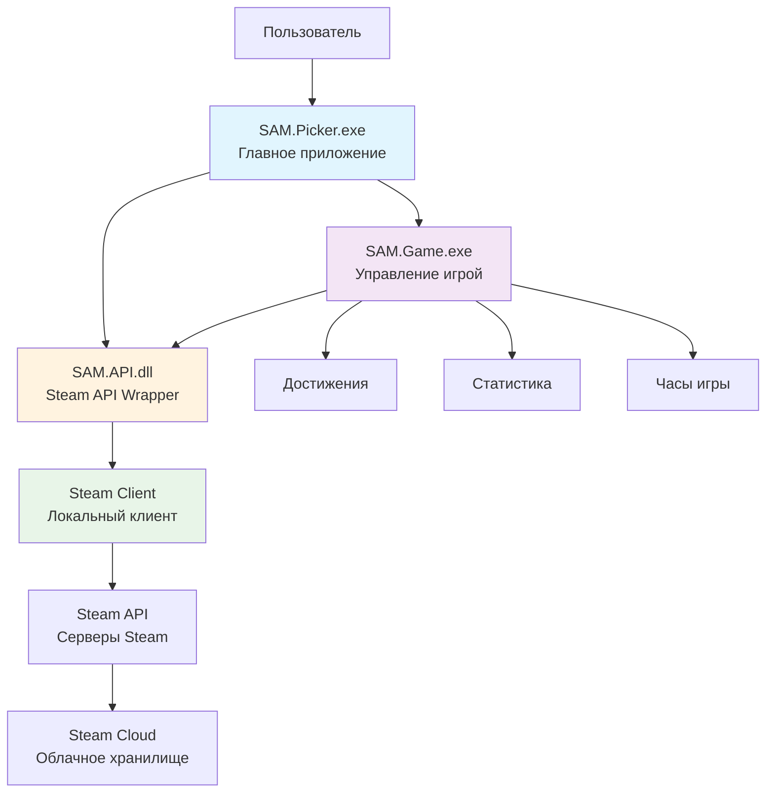

# Steam Achievement Manager (SAM)

## Описание проекта

**Steam Achievement Manager (SAM)** — это портативное приложение для управления достижениями и статистикой в игровой платформе Steam. Приложение позволяет пользователям управлять достижениями, статистикой и часами игры без необходимости фактического прохождения игр.

## 1. Структура проекта

```
SAM/
├── SAM.API.dll          # Библиотека API для работы с Steam
├── SAM.Game.exe         # Основное приложение для управления играми
└── SAM.Picker.exe       # Утилита выбора и управления играми
```

## 2. Описание файлов

### SAM.API.dll
- **Назначение**: Основная библиотека API для взаимодействия с Steam
- **Размер**: 30,208 байт
- **Ключевые функции**:
  - Управление достижениями Steam
  - Работа со статистикой игр
  - Взаимодействие с Steam API
- **Связи**: Используется основными исполняемыми файлами
- **Логика**: Предоставляет низкоуровневые функции для работы с Steam

### SAM.Game.exe
- **Назначение**: Основное приложение для управления конкретными играми
- **Размер**: 47,104 байт
- **Ключевые функции**:
  - Открытие/блокировка достижений
  - Изменение статистики игры
  - Управление часами игры
- **Связи**: Использует SAM.API.dll для работы с Steam
- **Логика**: Интерфейс для работы с достижениями конкретной игры

### SAM.Picker.exe
- **Назначение**: Утилита для выбора и добавления игр в библиотеку
- **Размер**: 49,152 байт
- **Ключевые функции**:
  - Просмотр всех игр пользователя
  - Добавление игр по ID
  - Поиск и фильтрация игр
- **Связи**: Использует SAM.API.dll, запускает SAM.Game.exe
- **Логика**: Главный интерфейс для навигации по играм

## 3. Архитектура проекта

### Общая структура

Проект построен по модульной архитектуре с разделением ответственности:

```
┌─────────────────┐    ┌─────────────────┐
│   SAM.Picker    │    │   SAM.Game      │
│   (Главное UI)  │────│   (Игровое UI)  │
└─────────────────┘    └─────────────────┘
         │                       │
         └───────────┬───────────┘
                     │
            ┌─────────────────┐
            │   SAM.API.dll   │
            │   (Steam API)   │
            └─────────────────┘
                     │
            ┌─────────────────┐
            │   Steam Client  │
            └─────────────────┘
```

### Потоки данных

1. **Инициализация**: SAM.Picker.exe → SAM.API.dll → Steam Client
2. **Выбор игры**: Пользователь → SAM.Picker.exe → SAM.Game.exe
3. **Управление достижениями**: SAM.Game.exe → SAM.API.dll → Steam API
4. **Синхронизация**: Steam API → Steam Cloud → Steam Profile

### Mermaid-схема архитектуры



## 4. Библиотеки/фреймворки

### Основные зависимости
- **Steam API**: Для взаимодействия с платформой Steam
- **.NET Framework**: Для исполнения .NET приложений
- **Windows API**: Для системных вызовов Windows

### Где используются
- **SAM.API.dll**: Содержит обёртки для Steam API
- **SAM.Game.exe**: Использует Steam API для управления играми
- **SAM.Picker.exe**: Использует Steam API для получения списка игр

## 5. Точка входа и запуск

### Как запускается проект

1. **Основной запуск**: `SAM.Picker.exe`
   - Загружает библиотеку игр пользователя
   - Отображает интерфейс выбора игр
   - Позволяет добавить игры по ID

2. **Запуск для конкретной игры**: `SAM.Game.exe`
   - Запускается из SAM.Picker.exe
   - Загружает данные конкретной игры
   - Предоставляет интерфейс управления достижениями

### Что выполняется первым

1. Проверка запущенного Steam клиента
2. Авторизация пользователя в Steam
3. Загрузка списка игр из библиотеки
4. Инициализация интерфейса

## 6. Архитектурные особенности

### Нестандартные решения

1. **Модульная архитектура**: Разделение на три компонента для лучшей организации кода
2. **Портативность**: Отсутствие установщика, работа из папки
3. **Минималистичный интерфейс**: Простой и понятный UI без излишеств

### Причины выбора архитектуры

1. **Безопасность**: Разделение API и UI снижает риск обнаружения
2. **Производительность**: Лёгкие исполняемые файлы быстро запускаются
3. **Удобство**: Пользователь может работать с любой игрой без перезапуска
4. **Совместимость**: Работа с различными версиями Steam

## 7. Функциональные возможности

### Основные функции

- ✅ **Управление достижениями**: Открытие/блокировка всех достижений
- ✅ **Статистика игр**: Изменение внутриигровых показателей
- ✅ **Часы игры**: Накрутка времени в играх
- ✅ **Карточки Steam**: Получение карточек для крафта
- ✅ **Поиск игр**: Добавление игр по Steam ID

### Ограничения

- ❌ Достижения на сторонних серверах (отмечены красным)
- ❌ Требует запущенный Steam клиент
- ❌ Требует авторизацию в Steam
- ❌ Максимум 32 игры одновременно

## 8. Использование

### Базовое использование

1. Запустите Steam и авторизуйтесь
2. Запустите `SAM.Picker.exe`
3. Выберите игру из списка или добавьте по ID
4. Дважды кликните по игре для открытия менеджера
5. Управляйте достижениями и статистикой
6. Нажмите "Commit Changes" для применения изменений

### Продвинутое использование

- **Постепенное получение достижений**: Для имитации естественного прохождения
- **Накрутка часов**: Для увеличения времени в игре
- **Получение карточек**: Для крафта эмодзи и фонов профиля
- **Исправление статистики**: Для корректировки внутриигровых данных

## 9. Технические требования

### Системные требования
- Windows 7/8/10/11
- .NET Framework 4.0+
- Запущенный Steam клиент
- Подключение к интернету

### Безопасность
- Приложение не требует прав администратора
- Не изменяет системные файлы
- Работает только с данными Steam

## 10. История разработки

- **2008**: Первый релиз с закрытым исходным кодом
- **2011**: Последний крупный релиз
- **2013**: Последнее обновление (хотфикс)
- **2019**: Открытие исходного кода (версия в проекте)
- **2024**: Обновления для совместимости

## 11. Заключение

Steam Achievement Manager представляет собой хорошо структурированное приложение с чётким разделением ответственности между компонентами. Модульная архитектура обеспечивает гибкость и простоту сопровождения, а минималистичный интерфейс делает приложение доступным для пользователей любого уровня.

Подпись относится к текущей версии проекта.

---

Автор: legenda  
Telegram: [@LEGENDA_SD](https://t.me/LEGENDA_SD)
